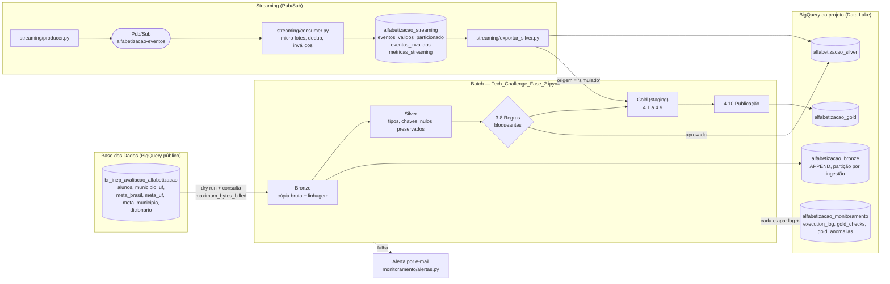

# Pipeline Híbrido para Análise da Alfabetização no Brasil

> **Vídeo Executivo, Apresentação & Documentação:** O arquivo de vídeo com a demonstração executiva está disponível para visualização no [Google Drive](https://drive.google.com/file/d/1B-RYowFcLgpXoGWNqEZ0Fh9H9NPJt-T4/view). A apresentação em PDF utilizada na gravação pode ser acessada em [`docs/Tech_Challenge_Fase_2.pdf`](docs/Tech_Challenge_Fase_2.pdf), e o detalhamento técnico completo de tipos, metadados e dicionário de dados encontra-se em [`Documentacao_Tecnica.md`](Documentacao_Tecnica.md).

---

### Resumo Executivo do Projeto

Pipeline de dados híbrido (batch + streaming) desenvolvido sob a **Arquitetura Medalhão (Bronze, Silver, Gold)** utilizando o ecossistema Google Cloud BigQuery e o dataset público `br_inep_avaliacao_alfabetizacao` da **Base dos Dados**. O projeto processa e audita mais de **3,9 milhões de registros de alunos**, integrando regras de qualidade bloqueantes (_Circuit Breaker_), monitoramento persistido com alertas automáticos por e-mail, e uma camada Gold estruturada especificamente para alimentar os modelos preditivos da Fase 3 de Inteligência Artificial.

---

## Sumário

1. [Contexto do problema](#1-contexto-do-problema)
2. [Arquitetura implementada](#2-arquitetura-implementada)
3. [Tecnologias: implementado x evolução futura](#3-tecnologias-implementado-x-evolução-futura)
4. [Decisões arquiteturais](#4-decisões-arquiteturais)
5. [Camadas e regras de negócio](#5-camadas-e-regras-de-negócio)
6. [Streaming](#6-streaming)
7. [Qualidade de dados](#7-qualidade-de-dados)
8. [Monitoramento e alertas](#8-monitoramento-e-alertas)
9. [FinOps e estimativa de custo](#9-finops-e-estimativa-de-custo)
10. [Resultados, validação cruzada e anomalias](#10-resultados-validação-cruzada-e-anomalias)
11. [Aplicação em IA (Fase 3)](#11-aplicação-em-ia-fase-3)
12. [Como executar](#12-como-executar)
13. [Estrutura do repositório e evidências](#13-estrutura-do-repositório-e-evidências)
14. [Limitações conhecidas](#14-limitações-conhecidas)

---

## 1. Contexto do problema

O **Compromisso Nacional Criança Alfabetizada** une União, estados, Distrito Federal e municípios com o objetivo estratégico de garantir que todas as crianças estejam plenamente alfabetizadas ao final do 2º ano do ensino fundamental. A partir dos microdados da _Pesquisa Alfabetiza Brasil_ (INEP, 2023), considera-se alfabetizado o estudante que atinge **743 pontos ou mais** na escala de proficiência do Saeb. O Indicador Criança Alfabetizada reflete o percentual de estudantes avaliados que alcançam esse patamar, ponderado rigorosamente pelo peso amostral.

Para a modelagem analítica e o acompanhamento de longo prazo até **2030**, o pipeline opera com duas leituras distintas de metas, aplicadas conforme o escopo da análise:

| Leitura                                    | Valor de Referência | Identificador / Onde Aparece no Repositório                                                                   |
| :----------------------------------------- | :------------------ | :------------------------------------------------------------------------------------------------------------ |
| **Meta pactuada da fonte (rede pública)**  | $80\%$              | `meta_alfabetizacao_2030 = 80` (utilizada na métrica `distancia_meta_pactuada_2030_pp` — a distância oficial) |
| **Universalização (cenário aspiracional)** | $100\%$             | Referenciada no identificador `distancia_cenario_aspiracional_2030_pp` (tratada como cenário de estresse)     |

> **Nota de Governança:** Toda comparação de desempenho do tipo "atingiu / não atingiu" realizada ao longo do pipeline utiliza estritamente a meta pactuada do ano correspondente, lida diretamente da tabela oficial de metas da fonte.

---

## 2. Arquitetura implementada

O projeto adota uma **arquitetura híbrida (batch e streaming)** estruturada sob o padrão **Medalhão (Bronze, Silver e Gold)** no Google Cloud BigQuery (`project-e55e388b-b16a-4618-8fd`). O pipeline principal é orquestrado via notebook (`Tech_Challenge_Fase_2.ipynb`), que realiza a extração controlada das fontes públicas, processamento local com validações estritas e carga persistente no Data Lake.

### 2.1 Diagrama Geral da Solução



---

## 3. Tecnologias: implementado x evolução futura

| Componente                           | Ferramenta                                                           | Status                                                                                     |
| ------------------------------------ | -------------------------------------------------------------------- | ------------------------------------------------------------------------------------------ |
| Fonte                                | BigQuery público (Base dos Dados)                                    | Implementado                                                                               |
| Processamento batch                  | Python 3.12, pandas, PyArrow, notebook Jupyter (execução local)      | Implementado                                                                               |
| Data lake (Bronze, Silver, Gold)     | Parquet local + **BigQuery** (`nuvem/lake.py`, load jobs)            | Implementado                                                                               |
| Mensageria                           | Google Cloud Pub/Sub                                                 | Implementado (executado de 17 a 29/10)                                                     |
| Consumo e armazenamento do streaming | `streaming/consumer.py` + BigQuery (tabela particionada)             | Implementado                                                                               |
| Qualidade de dados                   | `qualidade/verificador.py` (regras bloqueantes e informativas)       | Implementado                                                                               |
| Monitoramento                        | `monitoramento/registrador.py` (CSV acumulado + BigQuery)            | Implementado                                                                               |
| Alertas                              | E-mail via SMTP Gmail (`monitoramento/alertas.py`)                   | Implementado                                                                               |
| Testes automatizados                 | pytest (29 testes)                                                   | Implementado                                                                               |
| Controle de custo                    | `maximum_bytes_billed`, dry run, cache do BigQuery, BigQuery Sandbox | Implementado                                                                               |
| Orçamento com alertas                | Cloud Billing Budgets (R$ 30/mês, alertas em 50/90/100%)             | Configurado; sem efeito enquanto a conta de faturamento estiver encerrada (ver limitações) |
| Execução do notebook na nuvem        | Colab Enterprise (a célula 0 já suporta)                             | **Evolução futura**                                                                        |
| Orquestração e agendamento           | Cloud Composer / Cloud Scheduler                                     | **Evolução futura**                                                                        |
| Infraestrutura como código           | Terraform                                                            | **Evolução futura**                                                                        |
| Alerta de ausência de execução       | Cloud Monitoring                                                     | **Evolução futura**                                                                        |

---

## 4. Decisões arquiteturais

### 4.1 Forma de acesso à fonte: BigQuery nativo (e não download de arquivos)

- **Por quê:** Consultar as tabelas diretamente no BigQuery da _Base dos Dados_ elimina a necessidade de baixar, processar e versionar arquivos estáticos localmente. Essa abordagem preserva a linhagem nativa dos dados (rastreável via colunas de metadados como `_source_table` e IDs de job) e permite mensurar rigorosamente o custo de cada leitura com _dry run_.
- **Controle e Otimização de Custos:** Cada consulta avalia previamente os bytes necessários (_dry run_) e é executada com o parâmetro `maximum_bytes_billed` configurado (ex: `BATCH_MAX_BYTES_BILLED` de 10 GiB). Na execução oficial de 01/11, a ingestão completa processou 268,5 MB na tabela `alunos` e 332,4 MB faturados no total (respeitando o faturamento mínimo de 10 MiB por consulta do BigQuery). Não há transferência desnecessária entre nuvens, pois fonte e Data Lake compartilham o mesmo provedor. O tráfego de dados para o ambiente de execução utiliza a otimizada _BigQuery Storage Read API_.
- **Comportamento de Atualização da Fonte:** Quando a base oficial é atualizada, a execução subsequente realiza um novo _append_ na camada Bronze (preservando o histórico anterior) e recalcula as camadas Silver e Gold. O cache de consultas do BigQuery é invalidado automaticamente caso a tabela de origem sofra alterações, garantindo leitura fresca e faturamento integral quando há novos dados. Caso contrário, dentro da janela de 24 horas sem alterações na fonte, o cache retorna o resultado com 0 bytes faturados — comportamento observado e validado nas execuções 2 e 3 (ver seção de [FinOps](#9-finops-e-estimativa-de-custo)).

### 4.2 Batch x Streaming

| Critério                | Processamento Batch                                                                                         | Processamento Streaming                                                                                       |
| :---------------------- | :---------------------------------------------------------------------------------------------------------- | :------------------------------------------------------------------------------------------------------------ |
| **Uso Principal**       | Carga histórica completa (7 tabelas, 3,9 milhões de registros)                                              | Atualizações pontuais e simuladas de indicadores em tempo real                                                |
| **Frequência**          | Por execução do notebook (acionamento sob demanda)                                                          | Evento a evento; produtor configurado a cada 5 segundos                                                       |
| **Latência**            | 10,8 a 11,7 minutos de ponta a ponta nas execuções oficiais, incluindo a persistência no BigQuery           | Mediana de _0,89 segundos_ entre produção e ingestão, sem acúmulo de fila                                     |
| **Garantia de Entrega** | Execução com validações bloqueantes: qualquer falha interrompe o pipeline e evita cargas parciais corruptas | Arquitetura Pub/Sub com entrega garantida (at-least-once); deduplicação gerenciada por event_id no consumidor |
| **Unidade de Gravação** | Tabela completa por carga estruturada                                                                       | Micro-lotes otimizados (lotes de 10 eventos ou janela de 10 segundos)                                         |

### 4.3 Data lake x data warehouse

O Data Lake foi implementado **diretamente no BigQuery** (estruturado com um dataset por camada), e não no Google Cloud Storage:

- **Restrição e Contorno de Infraestrutura:** O projeto opera sem uma conta de faturamento ativa. O _BigQuery Sandbox_ é o único serviço de armazenamento analítico disponível sem faturamento (enquanto Cloud Storage e Pub/Sub exigem ativação de billing).
- **Separação de Papéis:** A camada Bronze atua genuinamente como "Lake" (cópia bruta, _append-only_, contendo metadados de linhagem). Já a Silver e a Gold consistem em tabelas analíticas consultáveis por SQL, prontas para consumo de dashboards e para os modelos da Fase 3.
- **Custo Zero Garantido:** Sem faturamento ativo na conta, elimina-se qualquer risco de cobrança de infraestrutura.

Os arquivos Parquet locais armazenados em `data_lake/` funcionam como o espelho local de cada camada. Vale destacar que a camada Gold em Parquet está versionada no repositório Git, servindo como resiliência técnica visto que as tabelas do BigQuery Sandbox expiram automaticamente após 60 dias.

### 4.4 Custo x performance

- **Otimização de Leitura:** A Bronze armazena a cópia integral da fonte (SELECT \*) para assegurar a reprodutibilidade do reprocessamento; a projeção e o filtro de colunas começam na Silver e na Gold (por exemplo, o parâmetro COLUNAS_ALUNOS na etapa 4.1 lê apenas 9 das 16 colunas disponíveis na Silver).
- **Particionamento Inteligente:** As tabelas Bronze no BigQuery são particionadas por data de ingestão, permitindo a leitura seletiva de partições quando as consultas aplicam filtros sobre a coluna de particionamento. Essa estratégia pode reduzir o volume de dados processados e melhorar a eficiência das consultas.
- **Publicação Controlada da Gold:** Os dados são preparados inicialmente em gold/\_staging/ e avançam para a etapa 4.10 após a aprovação das regras bloqueantes de qualidade. Os arquivos aprovados são transferidos para a camada Gold definitiva e carregados no BigQuery por meio de jobs com WRITE_TRUNCATE. Essa estratégia reduz o risco de propagação de dados inválidos, próximo de ser uma transação atômica entre todas as tabelas.
- **Eficiência no Streaming:** O processo de streaming interage com o BigQuery apenas uma vez por lote consolidado para executar a deduplicação (e não por evento individual), operando com um teto rígido de 1 GiB por consulta.

### 4.5 Política de escrita e preservação do histórico

| Camada            | Local (`data_lake/`)                                             | BigQuery                                                                                                                  | Comportamento do Histórico                                                                       |
| :---------------- | :--------------------------------------------------------------- | :------------------------------------------------------------------------------------------------------------------------ | :----------------------------------------------------------------------------------------------- |
| **Bronze**        | Um arquivo por carga: `<entidade>_raw_<timestamp>.parquet`       | `WRITE_APPEND` em `alfabetizacao_bronze.<entidade>_raw`, com partição diária por ingestão e coluna `_ingestion_timestamp` | **Preservado:** nenhuma execução apaga o histórico anterior                                      |
| **Silver**        | Arquivo substituído por versão limpa                             | `WRITE_TRUNCATE` sobre a tabela sanitizada                                                                                | **Derivada:** pode ser recriada integralmente a partir da Bronze                                 |
| **Gold**          | Gravada em `gold/_staging/` e publicada ativamente na etapa 4.10 | `WRITE_TRUNCATE` na base final de consumo                                                                                 | **Derivada e Segura:** a Gold anterior só é substituída se todas as regras de qualidade passarem |
| **Logs e Checks** | Arquivos CSV acumulados em modo _append_                         | `WRITE_TRUNCATE` com o espelho do CSV completo consolidado                                                                | **Preservado:** os relatórios de auditoria e logs apenas crescem                                 |

> 🔍 **Evidência de Rastreabilidade:** `evidencias/execucao_final/08_bronze_historico_2_cargas.png` — demonstra duas cargas sucessivas da entidade `municipio_raw` (23.995 linhas cada) coexistindo no BigQuery. Na terceira execução, o volume acumulou para 71.985 linhas, conforme registrado nos logs da etapa 2.2 do notebook.

---

## 5. Camadas e regras de negócio

### Uso das seis entidades (e do dicionário)

| Tabela da fonte                | Onde é usada na Gold                                                                                           |
| :----------------------------- | :------------------------------------------------------------------------------------------------------------- |
| `alunos`                       | 4.1: taxa recalculada e pesos (alunos avaliados) por município, UF e Brasil; 4.5 prova dos nove; 4.8 anomalias |
| `municipio`                    | 4.2: resultado x meta por município; 4.7 base de features                                                      |
| `uf`                           | 4.3: resultado x meta por UF; 4.5 prova dos nove                                                               |
| `meta_alfabetizacao_brasil`    | 4.4: resultado x meta nacional (traz a taxa oficial do Brasil)                                                 |
| `meta_alfabetizacao_uf`        | 4.3: meta por UF e taxa de 2025 (só existe nessa tabela)                                                       |
| `meta_alfabetizacao_municipio` | 4.2: meta por município                                                                                        |
| `dicionario`                   | 4.0–4.3: tradução de rede, série, presença, preenchimento e alfabetizado                                       |

### Bronze (`2.x` no notebook)

Cópia das 7 tabelas da fonte com colunas de linhagem: `_ingestion_timestamp`, `_source_table`, `_source_system`, `_record_hash`. Cada entidade é uma etapa monitorada. Erro de API ou rede **não** é mascarado: a etapa fica `FALHA`, o alerta é enviado e a execução é interrompida. O uso da última carga local só ocorre com `INGESTAO_MODO_OFFLINE=true` (testes sem rede).

### Silver (`3.1` a `3.8`)

- Tipos padronizados (identificadores e códigos como texto, métricas numéricas);
- **Nulo continua nulo** (nenhum preenchimento com `fillna(0)` em proficiência, taxa ou meta);
- Duplicatas exatas removidas e registradas como verificação (_check_);
- **3.8 — Validação bloqueante antes da Gold:** chaves sem nulo e sem repetição, `id_municipio` com 7 dígitos em todas as tabelas, `sigla_uf` entre as 27 UFs, e taxas e metas estritamente entre 0 e 100.

> **Decisão de Arquitetura — Integração e normalização de rede na Gold:** A camada Silver padroniza tipos e o formato das chaves (`id_municipio`, `sigla_uf`), mas a tradução de `rede` pelo dicionário e os cruzamentos entre tabelas ocorrem na camada Gold (etapas 4.0 a 4.3). **Motivo:** a rede aparece como código nas tabelas de resultado (`'3'`, `'5'`) e como texto nas tabelas de meta (`'Municipal'`, `'Pública'`). A chave comum (`rede_chave`) depende de uma regra de negócio específica (mapeamento da rede "Pública" das metas) validada junto com os joins. Concentrar os cruzamentos em um único local também permite mensurar a taxa de correspondência de todas as consultas com uma mesma função padronizada (`join_medido`).

### Gold (`4.0` a `4.10`)

| Tabela Gold                           | Conteúdo Principal                                                                              |
| :------------------------------------ | :---------------------------------------------------------------------------------------------- |
| `gold_municipio_resultado_vs_meta`    | Resultado x meta por município (rede municipal, 2º ano), oficial + eventos simulados (`origem`) |
| `gold_uf_resultado_vs_meta`           | Resultado x meta por UF (rede pública)                                                          |
| `gold_brasil_resultado_vs_meta`       | Resultado x meta nacional, com média ponderada e média simples das UFs                          |
| `gold_validacao_microdado_vs_oficial` | Prova dos nove: taxa recalculada dos alunos x taxa publicada oficialmente                       |
| `gold_evolucao_indicador`             | Série histórica e variação anual (calculada estritamente entre anos consecutivos)               |
| `gold_cenario_2030`                   | Tendência linear até 2030, explicitamente rotulada como "cenário, e não previsão"               |
| `gold_features_fase3`                 | Base de treino estruturada para a Fase 3, isolada sem vazamento de alvo (_data leakage_)        |
| `gold_numeros_video`                  | Consolidação de todos os indicadores quantitativos citados no vídeo executivo                   |

### Regras que evitam números errados (Aplicadas no código):

| Armadilha Potencial                               | Como foi tratada na Engenharia do Pipeline                                                                                                                                                        |
| :------------------------------------------------ | :------------------------------------------------------------------------------------------------------------------------------------------------------------------------------------------------ |
| **Join que não casa vira nulo**                   | Taxa de correspondência rigorosamente medida após cada join, com aplicação de limiar de alerta (ver seção 7)                                                                                      |
| **Chaves com idiomas diferentes**                 | Código de rede (resultados) x texto (metas) normalizados para `rede_chave`; tipagem das chaves validada antes de cada join (regra bloqueante)                                                     |
| **Nulo virar zero**                               | Política estrita contra preenchimento com zero: proficiência, taxa e metas nulas permanecem nulas                                                                                                 |
| **Comparar recortes diferentes**                  | Cruzamento de resultado e meta restrito à mesma rede e à série 2 (visto que as metas oficiais pertencem ao 2º ano do ensino fundamental)                                                          |
| **"Sem meta" virar "não atingiu"**                | Gestão em três estados distintos: `atingiu`, `não atingiu` e `sem meta cadastrada`, acompanhados da coluna `motivo_sem_meta`                                                                      |
| **Média simples como indicador nacional**         | Agregações ponderadas pelo volume de alunos avaliados; a média simples é mantida exclusivamente para comparação analítica, sob o nome explícito `taxa_media_simples_ufs`                          |
| **Denominador incorreto**                         | Taxa calculada corretamente como a soma dos pesos dos alunos alfabetizados dividida pela soma dos pesos dos **alunos avaliados** (presentes, com caderno preenchido, proficiência e peso válidos) |
| **Tradução inventada de códigos**                 | Códigos mapeados estritamente pela tabela `dicionario`; códigos não mapeados são rotulados como `Desconhecido` e **reprovam** nas checagens de qualidade                                          |
| **Rede "Pública" ambígua nas metas**              | Mapeamento validado: a meta genérica "Pública" corresponde nos dados à rede 5 (estadual + municipal), comprovado estatisticamente com correspondência em 49 de 49 casos nas UFs                   |
| **Trajetória de meta revisada**                   | A meta do ano $Y$ é extraída diretamente da linha de pactuação oficial correspondente ao ano $Y$                                                                                                  |
| **Ano sem pactuação própria (simulação de 2026)** | Utiliza a trajetória pactuada mais recente (2024), registrada na coluna `ano_pactuacao_meta`; anos anteriores à pactuação mantêm o status de `sem meta cadastrada`                                |
| **Extrapolação com poucos pontos**                | Projeção linear executada com base em 3 pontos históricos, rigorosamente rotulada como cenário analítico                                                                                          |

---

## 6. Streaming

**Versão executada e versão atual:** as evidências de Pub/Sub de 17 a 29/10/2026 correspondem à versão anterior do produtor, que gerava eventos com `ano=2026` para um único município (4118501). Na rodada final, esses eventos foram reexportados para a Silver e incorporados à Gold. O produtor atual usa `STREAMING_ANO=2024` e sorteia entre dez municípios por padrão, configuráveis por `STREAMING_MUNICIPIOS`. Essa revisão ainda não foi reexecutada com Pub/Sub após o encerramento do faturamento. Portanto, 2026 é o ano de referência dos eventos já registrados, enquanto 2024 é o padrão da versão atual do simulador.

**Fluxo:** `streaming/producer.py` → Pub/Sub (`alfabetizacao-eventos`) → `streaming/consumer.py` → BigQuery (`alfabetizacao_streaming`) → `streaming/exportar_silver.py` → `alfabetizacao_silver.streaming_eventos_validos` → Gold (4.2).

| Requisito                 | Implementação                                                                                                                         | Evidência (`evidencias/streaming_pubsub_2026-10/`) |
| ------------------------- | ------------------------------------------------------------------------------------------------------------------------------------- | -------------------------------------------------- |
| Mensageria                | Tópico e assinatura Pub/Sub (pull)                                                                                                    | `01`, `02`                                         |
| Processamento incremental | Micro-lote de 10 eventos ou 10 s de espera                                                                                            | `07`                                               |
| Evento inválido           | Campo ausente, valor fora de 0–100, JSON inválido → `eventos_invalidos` com `motivo_erro`                                             | `06`, `17`                                         |
| Evento duplicado          | `event_id` em memória + consulta ao BigQuery por lote; duplicata pendente só é confirmada após gravar o lote                          | `05`, `07`                                         |
| Latência real             | `produced_at` gravado pelo produtor, `ingested_at` pelo consumidor                                                                    | `07`, `13`                                         |
| Métricas                  | `metricas_streaming` (início, fim, duração, entradas, saídas, inválidos, status)                                                      | `08`                                               |
| Origem identificável      | `origem = 'simulado'` no evento, na Silver e na Gold (`fonte_taxa = 'streaming_simulado'`)                                            | notebook, 4.2                                      |
| Evento até a Gold         | 4.2 incorpora a Silver de eventos ("Eventos simulados incorporados: 1 (origem='simulado')") e compara com a meta, como o dado oficial | notebook, 4.2                                      |

**Latência medida** (62 eventos únicos exportados, 17 a 29/10): mediana **0,89 s** e p95 **2,5 s** nos 41 eventos consumidos em tempo real; 21 eventos ficaram na fila enquanto o consumidor estava desligado (até cerca de 5 dias) — a métrica mede espera na fila corretamente, mas esses eventos não representam a latência de processamento.

**O evento na Gold:** os eventos executados com Pub/Sub são de `ano=2026` e de um único município (4118501, rede municipal, 2º ano); a Gold mantém o último evento por município e ano, então resta **uma linha simulada**. Como ainda não existe pactuação de 2026, ela é comparada com a meta de 2026 da trajetória pactuada mais recente (2024): taxa simulada de **61,72%** contra meta de **79,0%**, status **`não atingiu`** (−17,3 p.p.), com `ano_pactuacao_meta = 2024`. O join com a meta é medido (1/1) como regra informativa.

Detalhes, comandos de criação e medições: [`docs/streaming_finops.md`](docs/streaming_finops.md).

---

## 7. Qualidade de dados

Ferramenta: [`qualidade/verificador.py`](qualidade/verificador.py). Toda regra é gravada em `data_lake/quality_reports/gold_checks.csv` (append; também no BigQuery em `alfabetizacao_monitoramento.gold_checks`). Regra **bloqueante** reprovada levanta `FalhaQualidadeBloqueante`, que não é capturada por nenhum `except` genérico: `monitorar_etapa` registra a falha, envia o alerta e repropaga a exceção.

| Tipo            | Regras                                                                                                                                                                                                                                                                                                                                                                                                                     |
| --------------- | -------------------------------------------------------------------------------------------------------------------------------------------------------------------------------------------------------------------------------------------------------------------------------------------------------------------------------------------------------------------------------------------------------------------------- |
| **Bloqueante**  | chave nula ou repetida; código fora do dicionário; rede desconhecida ou dois códigos virando a mesma rede; `id_municipio` fora do formato; UF inválida; taxa/meta fora de 0–100; tipos de chave diferentes num join; taxa de correspondência abaixo do limiar nos joins críticos; taxa da tabela de resultado diferente da tabela de meta (> 0,5 p.p. em mais de 5% dos casos); coluna que vaza o alvo na base de features |
| **Informativa** | percentual de nulos; duplicatas exatas removidas; aluno repetido no ano; anos sem tabela de meta; correspondência dos joins com microdados e comparações internas; convergência da prova dos nove; correlação máxima feature x alvo                                                                                                                                                                                        |

**Taxa de correspondência dos joins** — medida depois de **todo** join (`join_medido`):

| Join                                                              | Limiar  | Tipo        | Justificativa                                               | Resultado (01/11)                    |
| ----------------------------------------------------------------- | ------- | ----------- | ----------------------------------------------------------- | ------------------------------------ |
| município x meta municipal                                        | 90%     | bloqueante  | tolera municípios sem meta, que viram "sem meta cadastrada" | 97,8%                                |
| evento simulado x meta municipal                                  | 90%     | informativa | dado simulado não bloqueia a publicação do oficial          | 100% (1/1)                           |
| UF x meta UF                                                      | 95%     | bloqueante  | todas as UFs deveriam ter meta                              | 100%                                 |
| features x ano anterior                                           | 95%     | bloqueante  | município sem ano anterior sai da base de treino            | 99,0%                                |
| município x pesos dos alunos                                      | 95%     | informativa | cobertura dos microdados                                    | **94,2%** (reprovado, ver anomalias) |
| UF x pesos dos alunos                                             | 95%     | informativa | idem                                                        | 98,0%                                |
| Brasil x agregado UFs / x microdado                               | 100%    | informativa | 2025 não tem microdado e fica fora da medição               | 100%                                 |
| UF x microdado (prova dos nove)                                   | 95%     | informativa |                                                             | 97,9%                                |
| features x UF ano anterior                                        | 90%     | informativa | UF sem resultado no ano anterior fica nula                  | 100%                                 |
| comparações internas (média simples, ilustração, municípios x UF) | 95–100% | informativa | mesma origem dos dois lados                                 | 100%                                 |

**Falha demonstrada:** o Apêndice A do notebook roda [`qualidade/simular_falha.py`](qualidade/simular_falha.py), que aplica a regra de chave única a uma cópia da Silver de município com uma linha repetida. Resultado registrado: `FalhaQualidadeBloqueante`, código de saída 1, check `REPROVADO`, etapa `FALHA` no log (local e BigQuery) e e-mail recebido. Evidências: `06_alerta_email_falha_controlada.png` e `09_bigquery_falhas_registradas.png`.

---

## 8. Monitoramento e alertas

- **Métricas persistidas por etapa** ([`monitoramento/registrador.py`](monitoramento/registrador.py)): `run_id`, etapa, início, fim, duração, linhas de entrada e saída, bytes lidos, status e erro, acumulados em `execution_log.csv` e enviados ao BigQuery a cada etapa (inclusive na falha). Cobre as 7 entidades da Bronze, as 8 etapas da Silver e as 9 da Gold (4.2 a 4.10).
- **Falhas de ingestão:** erro na consulta ao BigQuery vira `FALHA` da etapa `bronze_<entidade>` e interrompe a execução.
- **Volume:** linhas de entrada e saída por etapa; bytes processados pela consulta (Bronze) e tamanho dos arquivos lidos (Silver, Gold 4.2–4.4). Nas etapas 4.5 a 4.9, `bytes_lidos` é uma estimativa de memória.
- **Latência:** duração de cada etapa no batch; `produced_at` → `ingested_at` no streaming.
- **Alerta:** e-mail com etapa, `run_id` e erro ([`monitoramento/alertas.py`](monitoramento/alertas.py)). O consumidor do streaming usa o mesmo alerta em falhas de gravação.

**Em produção, quem descobre que o pipeline quebrou, e em quanto tempo?** O endereço configurado em `GMAIL_DESTINATARIO` recebe o e-mail no momento da falha: a detecção acontece durante a etapa e o alerta é enviado logo depois do registro. No teste de 26/10, a falha foi gravada às 03:36:12 UTC e o e-mail chegou às 00:36 (horário de Brasília), menos de um minuto. **Lacuna:** sem agendador, uma execução que não acontece não gera alerta; o alerta por ausência de execução (Cloud Monitoring) está na evolução futura.

O histórico também mostra o próprio alerta falhando: nas tentativas de 22:15, 22:50 e 22:53 UTC de 01/11 a falha foi registrada, mas o e-mail não saiu (credencial do Gmail incorreta). O registro da falha não depende do envio do e-mail.

---

## 9. FinOps e estimativa de custo

### Práticas aplicadas

- **Armazenamento:** Parquet (compressão Snappy) nas camadas locais; Bronze no BigQuery particionada por data de ingestão; tabela de eventos do streaming particionada por dia com expiração de 60 dias.
- **Consultas:** dry run antes de cada consulta da ingestão; `maximum_bytes_billed` em todas as consultas (10 GiB na ingestão, 1 GiB no streaming); seleção de colunas a partir da Silver; deduplicação dos eventos válidos por lote (uma consulta por lote, com envio acionado ao atingir dez eventos ou pelo temporizador de dez segundos; o temporizador pode enviar um lote com menos de dez eventos).
- **Cache:** a segunda e a terceira execuções de 01/11 leram as 7 tabelas da fonte com **0 byte processado e 0 faturado** (cache do BigQuery), mesmo com o dry run indicando 268,5 MB nos alunos.
- **Recursos:** BigQuery Sandbox — não há faturamento, portanto não há cobrança possível; consultas limitadas a 1 TiB/mês e armazenamento a 10 GiB.

### Números medidos

| Medição                                             | Valor                                                                                                                              | Origem                              |
| --------------------------------------------------- | ---------------------------------------------------------------------------------------------------------------------------------- | ----------------------------------- |
| Ingestão, execução 1 (sem cache)                    | 271,5 MB processados, **332,4 MB faturados** (7 consultas; 6 delas no mínimo de 10 MiB)                                            | saída 2.2 do notebook, Job IDs      |
| Ingestão, execuções 2 e 3 (com cache)               | **0 byte** faturado                                                                                                                | saída 2.2 do notebook               |
| Armazenamento no BigQuery (01/11, após 3 execuções) | **3,08 GB** no total: Bronze 2,30 GB (3 cargas), Silver 0,77 GB, Gold 5,3 MB, monitoramento e streaming < 0,1 MB                   | metadados das tabelas               |
| Crescimento da Bronze por carga                     | **+0,76 GB** (quase tudo em `alunos_raw`)                                                                                          | metadados das tabelas               |
| Load jobs por execução                              | cerca de 75 (Bronze, Silver, Gold e relatórios)                                                                                    | saída do notebook                   |
| Duração de uma execução                             | 10,8 a 11,7 min de ponta a ponta; etapas mais longas: Silver `alunos` 81–91 s, Bronze `alunos` 66–76 s, publicação da Gold 59–68 s | `execution_log.csv`                 |
| Deduplicação do streaming                           | 3.213 B processados, 10 MiB faturados por consulta                                                                                 | `streaming_pubsub_2026-10/05`       |
| Consulta representativa do streaming                | 496 B processados, 347 ms, 49 ms de slot                                                                                           | `streaming_pubsub_2026-10/14`, `15` |

### Custo atual

**R$ 0,00.** O projeto está no BigQuery Sandbox (sem conta de faturamento ativa) e todo o uso está dentro dos limites gratuitos.

### Projeção para produção (mesmo desenho, com faturamento)

Cadência pretendida: **batch semanal** (a fonte muda poucas vezes por ano, mas a revisão de metas pode ocorrer a qualquer momento) e **streaming de 100 mil eventos/dia**. Preços de referência do BigQuery on-demand (multirregião US) e Pub/Sub; conferir em [cloud.google.com/bigquery/pricing](https://cloud.google.com/bigquery/pricing).

| Serviço                                           | Unidade      | Quantidade medida                                            | Preço unitário                             | Custo mensal projetado                                  |
| ------------------------------------------------- | ------------ | ------------------------------------------------------------ | ------------------------------------------ | ------------------------------------------------------- |
| BigQuery — consultas da ingestão batch            | TiB faturado | 332,4 MB por execução × 4,3 execuções/mês ≈ 1,4 GB           | US$ 6,25/TiB (1 TiB/mês grátis)            | **US$ 0,00** (sem franquia: US$ 0,01)                   |
| BigQuery — armazenamento (Bronze acumulada)       | GiB-mês      | 3,08 GB hoje; +0,76 GB por carga ≈ +3,3 GB/mês               | US$ 0,02/GiB-mês ativo (10 GiB/mês grátis) | Mês 1–2: **US$ 0,00**; mês 12 (≈ 43 GB): **≈ US$ 0,66** |
| BigQuery — load jobs (Bronze, Silver, Gold, logs) | job          | ≈ 75 por execução                                            | gratuito (pool compartilhado)              | **US$ 0,00**                                            |
| BigQuery — deduplicação do streaming              | TiB faturado | 10 MiB faturados por consulta × 300 mil lotes/mês ≈ 2,86 TiB | US$ 6,25/TiB após 1 TiB                    | **≈ US$ 11,63** (piso)                                  |
| Pub/Sub — publicação e entrega                    | GiB          | premissa de 1 KB/evento ≈ 6 GB/mês (não medido diretamente)  | US$ 40/TiB após 10 GiB                     | **US$ 0,00**                                            |
| **Total**                                         |              |                                                              |                                            | **≈ US$ 11,63 no 1º mês; ≈ US$ 12,30 no 12º mês**       |

**Leitura da projeção:** o custo dominante é a deduplicação do streaming (piso de faturamento de 10 MiB por consulta), não o batch. No batch, o único item que cresce é a Bronze, porque cada carga anexa uma cópia de 0,76 GB mesmo quando a fonte não mudou. A otimização prevista é só ingerir a tabela `alunos` quando a fonte for atualizada (comparando a data de modificação da tabela de origem), o que manteria a Bronze dentro da franquia de 10 GiB.

---

## 10. Resultados, validação cruzada e anomalias

### Prova dos nove (microdado x indicador oficial)

- **141 de 144** recortes UF × rede × ano recalculados a partir dos alunos ficaram a até 0,5 p.p. da taxa publicada.
- **Brasil 2024: 59,20% recalculado = 59,2% publicado.**
- A média **ponderada** dos municípios erra 0,01–0,02 p.p. contra a taxa da UF; a média **simples** erra 3,4–4,1 p.p.
- Usando todos os registros no denominador (com ausentes), a taxa de 2024 cairia de 59,2% para 52,2%.

### Principais resultados (fonte: `gold_numeros_video`)

| Indicador                                                        | Valor                                                         |
| ---------------------------------------------------------------- | ------------------------------------------------------------- |
| Taxa Brasil, rede pública: 2023 / 2024 / 2025                    | 55,9% / 59,2% / 66,0%                                         |
| Meta pactuada Brasil: 2024 / 2025                                | 59,9% (não atingiu) / 64,0% (atingiu)                         |
| Meta pactuada 2030 (fonte)                                       | 80% — distância a partir de 2025: **14,0 p.p.**               |
| Cenário aspiracional (100%)                                      | distância a partir de 2025: 34,0 p.p.                         |
| Tendência linear até 2030 (cenário com 3 pontos, não é previsão) | 90,7%                                                         |
| Municípios em 2024                                               | 2.788 atingiram, 2.444 não atingiram, 216 sem meta cadastrada |
| UFs em 2025                                                      | maior taxa: CE 84%; menor: RN 48%                             |

### Anomalias investigadas

| #   | Anomalia                                                                                                                          | Conclusão                                                                                                                                                                                                                                                                              |
| --- | --------------------------------------------------------------------------------------------------------------------------------- | -------------------------------------------------------------------------------------------------------------------------------------------------------------------------------------------------------------------------------------------------------------------------------------- |
| 1   | Duas redes "públicas" no dicionário (5 e 6) e meta que diz só "Pública"                                                           | É a rede 5 (estadual + municipal): bate em 49 de 49 UFs; a rede 6 não aparece em nenhuma linha                                                                                                                                                                                         |
| 2   | Trajetória da meta muda conforme o ano de pactuação (Brasil: 59,9/63,77/… em 2023–24; 60/64/… em 2025; 20 a 25 UFs revisadas)     | A meta de cada ano é lida da linha daquele ano; a meta de 2030 não mudou                                                                                                                                                                                                               |
| 3   | 2025 só existe nas tabelas de meta                                                                                                | Taxa 2025 das UFs vem da tabela de meta (`fonte_taxa = meta_alfabetizacao_uf`) e fica fora da prova dos nove                                                                                                                                                                           |
| 4   | Brasil 2023 não fecha com as UFs (55,9% publicado x 57,46% ponderado e no microdado)                                              | Cada UF bate individualmente e 2024 fecha em 0,01 p.p.; suspeita de outro método na linha de base nacional, **não confirmada**; mantido o número oficial                                                                                                                               |
| 5   | Níveis de proficiência vazios em 2023                                                                                             | `proporcao_aluno_nivel_*` só existe a partir de 2024; colunas removidas da base de features                                                                                                                                                                                            |
| 6   | 120 municípios sem meta de 2024 e sem taxa em 2023; Roraima sem meta estadual                                                     | Classificados como `sem meta cadastrada`, com o motivo                                                                                                                                                                                                                                 |
| 7   | 13,3% dos alunos sem proficiência (513.338 de 3.867.999)                                                                          | São ausentes ou com caderno não preenchido; ficam fora do denominador                                                                                                                                                                                                                  |
| 8   | Recortes fora da tolerância na prova dos nove: MT 2023 (+1,49 p.p.) e PB 2024 (+0,70 p.p.)                                        | Causa não identificada; resultado oficial mantido                                                                                                                                                                                                                                      |
| 9   | 3 municípios com taxa diferente entre tabela de resultado e de meta (até 36 p.p.)                                                 | Erro pontual da fonte, registrado (abaixo do limiar bloqueante de 5%)                                                                                                                                                                                                                  |
| 10  | Correspondência município x pesos dos alunos em 94,2% (627 linhas oficiais sem microdado)                                         | Check informativo reprovado em todas as execuções; cobertura dos microdados menor que a da tabela de resultado. **Não investigado a fundo**                                                                                                                                            |
| 11  | Streaming: 91 linhas e 62 `event_id` únicos em `eventos_validos_particionado` (29 duplicatas em 19, 20 e 23/10; nenhuma em 29/10) | Consistente com a deduplicação apenas em memória, que se perdia ao reiniciar o consumidor; em 29/10, com a consulta ao BigQuery por lote, a duplicata proposital não foi gravada. A Silver e a Gold recebem só os 62 únicos. A data exata da mudança no código não pôde ser confirmada |

Diagnósticos completos: `data_lake/quality_reports/gold_anomalias.csv` e seção 4.8 do notebook.

---

## 11. Aplicação em IA (Fase 3)

`gold_features_fase3` — uma linha por município (rede municipal), 5.396 linhas:

- **Alvo:** `alvo_taxa_alfabetizacao` do ano _t_.
- **Features:** só o que já se sabia antes da prova de _t_: taxa, proficiência média, participação e alunos avaliados do ano anterior; taxa da UF (rede pública) no ano anterior; meta pactuada do ano.
- **Vazamento de alvo:** colunas do mesmo ano que vêm da mesma prova (proficiência, níveis, status da meta, distâncias etc.) estão numa lista proibida, e uma regra **bloqueante** impede que entrem. A maior correlação de uma feature com o alvo é 0,65 (`media_portugues_ano_anterior`).
- **Limitação:** resultados municipais só vão até 2024, então há um único ano-alvo (2024). Com um ano novo, é possível treinar em _t_ e validar em _t+1_.

**Usos:**

- prever quais municípios tendem a não atingir a meta do ano seguinte e priorizar apoio antes da avaliação;
- medir a desigualdade entre e dentro das UFs ao longo do tempo (em 2025, de 48% no RN a 84% no CE);
- separar quem precisa de apoio (não atingiu) de quem primeiro precisa ter meta cadastrada (216 municípios em 2024).

A Gold fica no BigQuery (`alfabetizacao_gold`) e em Parquet versionado em `data_lake/gold/`.

---

## 12. Como executar

### Pré-requisitos

- Python **3.12** e [Google Cloud CLI](https://cloud.google.com/sdk/docs/install).
- Projeto GCP com BigQuery (funciona no **Sandbox**, sem faturamento). O streaming com Pub/Sub exige faturamento ativo.
- Para o alerta: conta Gmail com verificação em duas etapas e uma **senha de app** (16 letras).

### Passo a passo (Terminal do VS Code; no Windows use `.venv\Scripts\Activate`, no Linux/macOS `source .venv/bin/activate`)

```bash
git clone <url-do-repositorio>
cd <pasta-do-repositorio>
python -m venv .venv
# Ative a venv conforme seu sistema operacional (.venv\Scripts\Activate ou source .venv/bin/activate)
pip install -r requirements.txt  # Instala as dependências validadas (Pandas, PyArrow, SDK do BigQuery, Pytest, etc.)

gcloud auth login
gcloud auth application-default login
gcloud config set project SEU_PROJECT_ID
gcloud auth application-default set-quota-project SEU_PROJECT_ID

copy .env.example .env      # preencher GCP_PROJECT_ID e GMAIL_*
python -m pytest tests -v   # 29 testes
```

1. **Reprodução do streaming** (exige Pub/Sub e faturamento ativo): criar tópico, assinatura e tabelas conforme [`docs/streaming_finops.md`](docs/streaming_finops.md); rodar `python streaming/consumer.py` e, em outro terminal, `python streaming/producer.py`. O streaming faz parte da solução entregue. Para consultar os resultados já registrados sem publicar novos eventos, utilize as evidências em `evidencias/streaming_pubsub_2026-10/` e as saídas salvas do notebook; essa consulta não equivale a uma nova execução do fluxo.
2. **Exportar os eventos para a Silver** (exige as tabelas do streaming): `python streaming/exportar_silver.py`. Sem esse arquivo, o notebook segue sem eventos simulados e mostra um aviso na 4.2.
3. **Pipeline batch:** abrir `Tech_Challenge_Fase_2.ipynb` com o kernel da `.venv` e executar tudo. Os datasets `alfabetizacao_bronze`, `_silver`, `_gold` e `_monitoramento` são criados automaticamente. O Apêndice A executa a falha controlada (o e-mail de alerta é enviado e o código de saída 1 é o esperado).
4. **Só a falha controlada:** `python -m qualidade.simular_falha`.
5. **Só o canal de alerta:** `python -m monitoramento.teste_alerta`.

Sem `LAKE_BIGQUERY=true` no `.env`, o pipeline roda só localmente (útil para testes).

### Configuração (`.env`)

Todos os identificadores ficam num único arquivo, [`.env.example`](.env.example): projeto, prefixo e localização dos datasets, tabelas do streaming, tetos de bytes e credenciais do alerta. O `.env` e qualquer chave de service account estão no `.gitignore`.

---

## 13. Estrutura do repositório e evidências

A estrutura do repositório organiza os componentes de ingestão, transformação, qualidade, monitoramento, streaming e publicação dos dados, além dos arquivos de evidência utilizados para demonstrar o funcionamento do pipeline.

```text
Tech_Challenge_Fase_2.ipynb    Pipeline batch (Bronze, Silver, Gold, publicação e Apêndice A)
Documentacao_Tecnica.md        Documentação técnica detalhada de dados e regras de negócio
nuvem/lake.py                  Persistência das camadas no BigQuery (load jobs)
qualidade/verificador.py       Regras de qualidade bloqueantes e informativas
qualidade/simular_falha.py     Simulação controlada de falha de qualidade
monitoramento/registrador.py   Métricas e logs por etapa, com publicação no BigQuery
monitoramento/alertas.py       Notificações automáticas por e-mail
streaming/                     producer.py, consumer.py, exportar_silver.py
tests/                         Testes automatizados de transformações, qualidade e lake
data_lake/
  bronze/, silver/, gold/       Parquet local (fora do Git; recriados pelo pipeline/BigQuery)
  quality_reports/              execution_log.csv, gold_checks.csv, gold_anomalias.csv, silver_checks.csv
docs/                           streaming_finops.md, Tech_Challenge_Fase_2.pdf
evidencias/
  execucao_final/              Evidências da execução final de 01/11/2026
  streaming_pubsub_2026-10/    Evidências do streaming com Pub/Sub (17 a 29/10)
  monitoramento_2026-10/       Evidências do teste de alerta de 26/10/2026
```

Os arquivos Parquet locais das camadas Bronze e Silver são mantidos fora do versionamento Git, enquanto seus dados também são persistidos no BigQuery. A camada Gold é preservada em arquivos Parquet versionados no repositório, permitindo sua reutilização na Fase 3.

### 13.1 Evidências de execução e monitoramento

Os arquivos abaixo estão organizados na pasta evidencias/.

| Evidência                                               | O que comprova                                                                                                                                    |
| ------------------------------------------------------- | ------------------------------------------------------------------------------------------------------------------------------------------------- |
| execucao_final/01_orcamento_bigquery_pubsub_storage.png | Configuração do orçamento e dos alertas de custo para BigQuery, Pub/Sub e Cloud Storage. A existência do orçamento não implica faturamento ativo. |
| execucao_final/02_testes_28_aprovados.png               | Aprovação de 28 testes automatizados. O 29º teste foi incluído posteriormente e não está representado nessa captura.                              |
| execucao_final/03_exportacao_silver_streaming.png       | Exportação de eventos do streaming para a camada Silver no BigQuery.                                                                              |
| execucao_final/04_anomalia_duplicatas_streaming.png     | Investigação de registros duplicados nos eventos de streaming.                                                                                    |
| execucao_final/05_anomalia_duplicatas_por_dia.png       | Análise da ocorrência de duplicidades de streaming por dia.                                                                                       |
| execucao_final/06_alerta_email_falha_controlada.png     | Evidência do alerta por e-mail associado à falha controlada de 01/11/2026.                                                                        |
| execucao_final/07_bigquery_datasets.png                 | Estrutura dos datasets das camadas do projeto no BigQuery.                                                                                        |
| execucao_final/08_bronze_historico_2_cargas.png         | Preservação do histórico de duas cargas na camada Bronze, conforme o momento da captura.                                                          |
| execucao_final/09_bigquery_falhas_registradas.png       | Registros de falhas de execução publicados no BigQuery.                                                                                           |
| monitoramento_2026-10/01_falha_pipeline.png             | Exceção simulada durante o teste de monitoramento de 26/10/2026.                                                                                  |
| monitoramento_2026-10/02_registro_falha.csv.png         | Registro da falha no arquivo de monitoramento.                                                                                                    |
| monitoramento_2026-10/03_email_alerta_recebido.png      | Recebimento do e-mail de alerta no teste de 26/10/2026.                                                                                           |

As evidências da execução final documentam a publicação das camadas, os testes automatizados, o acompanhamento de custos e os mecanismos de qualidade. As evidências de monitoramento permitem verificar separadamente o registro de falhas e o funcionamento das notificações por e-mail.

### 13.2 Testes de falha e alertas automáticos

O mecanismo de monitoramento registra falhas de execução e realiza tentativas automáticas de notificação por e-mail. Os registros são mantidos em data_lake/quality_reports/execution_log.csv e podem ser publicados no dataset alfabetizacao_monitoramento do BigQuery.

_Teste de monitoramento — 26/10/2026_

Em 26/10/2026, foi realizado um teste utilizando uma exceção simulada do tipo ValueError, na etapa TESTE_FALHA_EMAIL, com o identificador TESTE-ALERTA-001.

O teste demonstrou o registro da falha e o recebimento do alerta no Gmail em menos de um minuto, conforme os horários documentados nas evidências da pasta evidencias/monitoramento_2026-10/.

Esse resultado comprova o funcionamento do canal de notificação no cenário testado. O tempo de recebimento pode variar conforme a conexão e a disponibilidade do serviço de e-mail.

_Falha controlada de qualidade — 01/11/2026_

O módulo qualidade/simular_falha.py implementa uma simulação controlada de duplicidade na camada Silver de municípios.

Nesse procedimento, uma linha duplicada é inserida em uma cópia dos dados em memória. A função checar_chave_unica identifica a duplicidade e provoca os seguintes resultados:

- Registro da regra bloqueante com status REPROVADO em gold_checks.csv.
- Registro da etapa falha_controlada_silver_municipio com status FALHA em execution_log.csv.
- Lançamento da exceção FalhaQualidadeBloqueante.
- Encerramento do processo de teste com código de saída 1.
- Acionamento do mecanismo de alerta por e-mail.
- Publicação dos registros de monitoramento no BigQuery.

A simulação preserva o arquivo Silver original, pois utiliza uma cópia dos dados em memória.

O teste demonstra que uma regra bloqueante reprovada gera uma exceção, registra a ocorrência e interrompe o processo controlado. Por se tratar de uma execução isolada, não constitui prova de atomicidade entre todas as tabelas publicadas na Gold.

O notebook registra essa demonstração no _Apêndice A_, com o identificador:

FALHA_CONTROLADA_20261101_235525

As saídas salvas mostram a reprovação da regra, o encerramento com código 1, os registros de monitoramento e a confirmação do acionamento do alerta.

### 13.3 Execuções batch e rastreabilidade

O notebook salvo contém as saídas da execução batch 20261101_234421, correspondente à terceira execução de 01/11/2026.

Nessa execução, as consultas de ingestão utilizaram o cache do BigQuery, resultando em _0 byte faturado nas consultas de origem_, conforme os resultados registrados.

A primeira execução batch do mesmo dia, identificada por 20261101_220215, foi realizada sem o mesmo aproveitamento de cache. Seus registros de execução e métricas de leitura estão preservados em:

data_lake/quality_reports/execution_log.csv

Os relatórios de monitoramento e qualidade incluem:

- execution_log.csv: identificação das execuções, etapas, duração, volumes processados, status e erros.
- gold_checks.csv: regras de qualidade executadas, resultados, limites e identificação das execuções.
- gold_anomalias.csv: registros de anomalias identificadas durante o processamento analítico.

Esses arquivos, em conjunto com as saídas do notebook e as evidências visuais, permitem rastrear as execuções, verificar a atuação das regras de qualidade e consultar os resultados de monitoramento.

---

## 14. Limitações conhecidas

- **Execução local:** o notebook roda na máquina local; a fonte, o processamento das consultas e o armazenamento das camadas estão no BigQuery. A execução no Colab Enterprise está prevista (célula 0), mas não foi feita.
- **Faturamento encerrado:** a conta de faturamento do projeto foi encerrada depois das execuções do streaming. Por isso: o projeto está no BigQuery Sandbox; o Pub/Sub não pôde ser executado na rodada final; o orçamento do print `01` existe, mas não monitora gastos enquanto não houver conta ativa (o Sandbox não permite cobrança).
- **Streaming na rodada final:** foram reexportados e incorporados à Gold os eventos de execuções anteriores, conforme explicado na [seção 6](#6-streaming). A versão atual do produtor e o alerta integrado ao consumidor ainda não foram executados com Pub/Sub.
- **Expiração no Sandbox:** tabelas expiram em 60 dias (Silver, Gold e monitoramento em 31/12/2026; partições da Bronze em 60 dias). A Gold e os relatórios ficam versionados no repositório.
- **Sem orquestração:** as etapas são encadeadas no notebook (cada uma para em caso de falha), mas não há agendamento nem retentativa automática.
- **Bronze cresce a cada execução**, mesmo sem mudança na fonte (ver FinOps).
- **Um único ano-alvo** na base da Fase 3 (2024).
- **Anomalias sem causa confirmada:** Brasil 2023, MT 2023, PB 2024 e a cobertura de 94,2% dos microdados por município.
- **Projeção de custo** do Pub/Sub usa premissa de 1 KB por evento (não medido).
